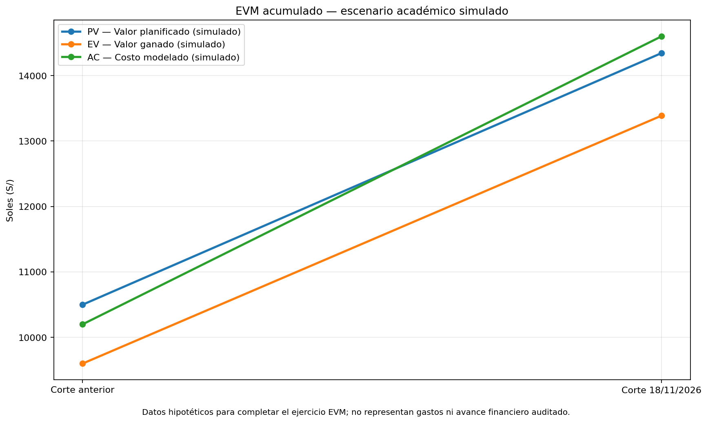
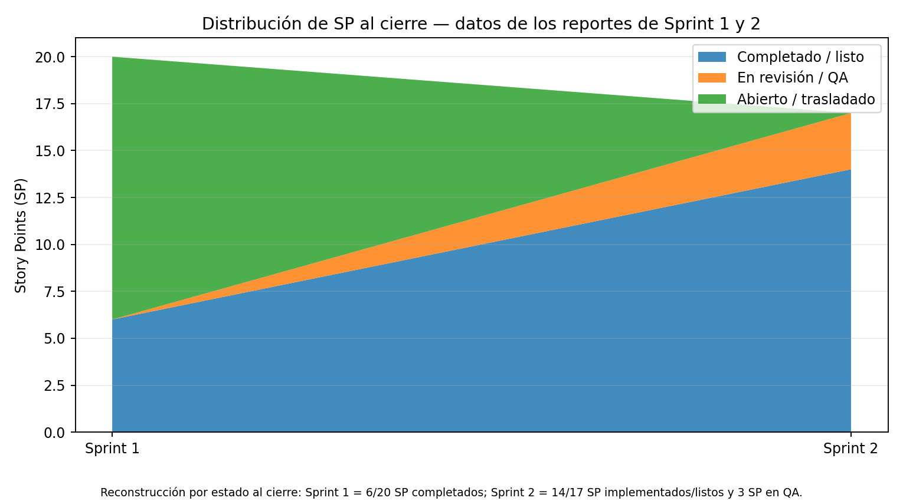
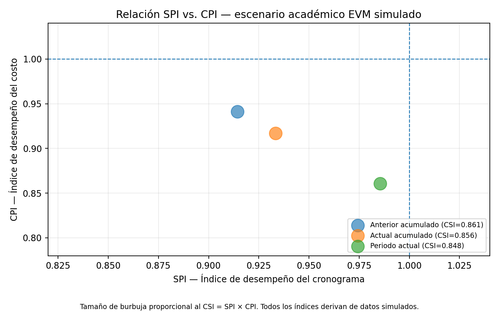
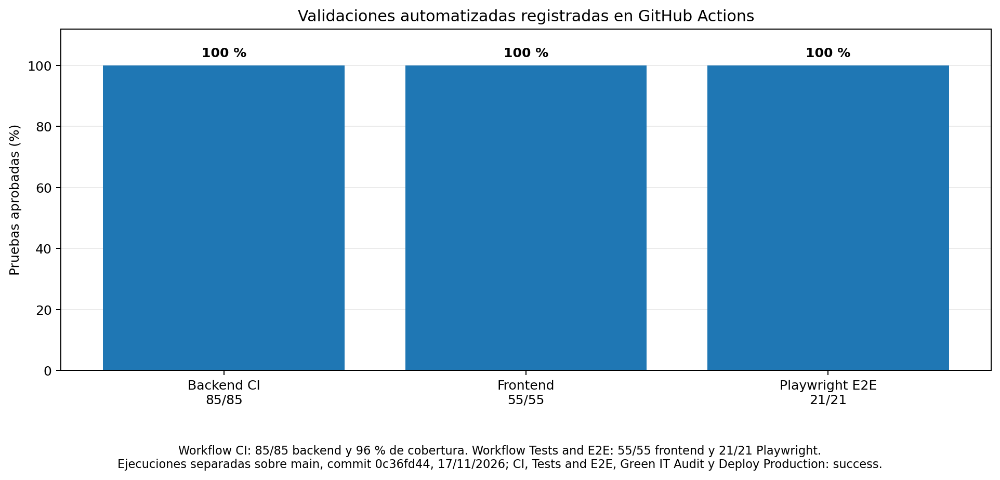

# 03. Reporte de Análisis de Valor Ganado — EVM

[← Volver al README principal](../../README.md)

| Campo | Información |
|---|---|
| Proyecto | EcoLogística Huancayo (EcoLogistics) |
| BAC | S/ 15,937.60 |
| Estado general | Simulación académica de desempeño para fines de evaluación; no es un reporte financiero real |
| Fecha de corte del escenario | 18/11/2026 |
| Versión | V_1_0_0 |

> **Advertencia de integridad:** el presupuesto de S/ 15,937.60 procede del presupuesto académico referencial del repositorio. No se halló registro real de costos ejecutados ni una medición monetaria del valor ganado. Para demostrar el método EVM se utilizan supuestos simulados, identificados en todas las tablas y gráficas. No presentar PV, EV o AC simulados como transacciones o mediciones históricas reales.

## 1. Métricas de desempeño EVM

Los valores del periodo actual y los acumulados son supuestos didácticos coherentes entre sí. El acumulado actual es la suma del periodo anterior y del periodo actual.

| Métrica / indicador | Periodo actual (simulado) | Acumulado periodo actual (simulado) | Acumulado periodo anterior (simulado) |
|---|---:|---:|---:|
| Valor Planificado (PV) | S/ 3,843.84 | S/ 14,343.84 | S/ 10,500.00 |
| Valor Ganado (EV) | S/ 3,787.58 | S/ 13,387.58 | S/ 9,600.00 |
| Costo Real (AC) | S/ 4,400.00 | S/ 14,600.00 | S/ 10,200.00 |
| Variación del Cronograma (SV = EV − PV) | −S/ 56.26 | −S/ 956.26 | −S/ 900.00 |
| Variación del Costo (CV = EV − AC) | −S/ 612.42 | −S/ 1,212.42 | −S/ 600.00 |
| Índice de Desempeño del Cronograma (SPI = EV / PV) | 0.9854 | 0.9333 | 0.9143 |
| Índice de Desempeño del Costo (CPI = EV / AC) | 0.8608 | 0.9170 | 0.9412 |

**Lectura acumulada:** SV menor que cero y SPI menor que 1 representan atraso frente al valor planificado del escenario. CV menor que cero y CPI menor que 1 representan menor valor ganado por cada sol modelado como costo. Los índices no equivalen directamente a días de atraso ni a dinero realmente gastado.

## 2. Porcentajes de avance acumulado respecto al BAC

- **Porcentaje planificado (PV / BAC):** 14,343.84 / 15,937.60 = **90.00 %**.
- **Porcentaje ganado (EV / BAC):** 13,387.58 / 15,937.60 = **84.00 %**.
- **Porcentaje gastado (AC / BAC):** 14,600.00 / 15,937.60 = **91.61 %**.

Estos porcentajes pertenecen al escenario simulado y no representan porcentajes medidos del software ni desembolsos reales.

## 3. Análisis de desviaciones

- **Causa raíz modelada de la variación del cronograma:** incorporación tardía de alcance en Sprint 1, traslado de 14 SP al backlog y esfuerzo de integración/calidad distribuido entre Sprints posteriores. Los registros de Sprint 1 y 2 respaldan estos eventos; la cuantificación monetaria del SV sigue siendo supuesta.
- **Impacto modelado:** al corte simulado, el EV alcanza 84 % del BAC frente a 90 % planificado. La diferencia equivale a −S/ 956.26 de SV; no se interpreta como días.
- **Causa raíz modelada de costo:** trabajo adicional de integración, pruebas de navegador, CI, correcciones y consolidación documental; el costo AC de S/ 14,600 es supuesto.
- **Impacto modelado:** CV acumulado −S/ 1,212.42 y CPI 0.9170. No se declara sobrecosto financiero real sin libro de gastos.

## 4. Estimaciones a la conclusión (EAC)

Se utilizan CPI y SPI acumulados actuales: CPI = 13,387.58 / 14,600.00 = 0.9170; SPI = 13,387.58 / 14,343.84 = 0.9333 (los cálculos conservan precisión completa antes del redondeo).

1. **Fórmula 1 — EAC = BAC / CPI**

   S/ 15,937.60 / 0.9169575 = **S/ 17,380.96**.

2. **Fórmula 2 — EAC = BAC / (CPI × SPI)**

   S/ 15,937.60 / (0.9169575 × 0.9333439) = **S/ 18,622.46**.

3. **Fórmula 3 — EAC = AC + [(BAC − EV) / (CPI × SPI)]**

   S/ 14,600.00 + [(S/ 15,937.60 − S/ 13,387.58) / (0.9169575 × 0.9333439)] = **S/ 17,579.60**.

**EAC seleccionado: Fórmula 3 (S/ 17,579.60).** Se prefiere porque conserva el costo acumulado simulado hasta la fecha (AC) y estima el costo del trabajo pendiente aplicando conjuntamente el rendimiento de costo y cronograma. La Fórmula 1 solo prolonga la eficiencia de costo; la Fórmula 2 ajusta todo el BAC por ambos índices, sin separar explícitamente el costo ya incurrido. Las tres proyecciones son escenarios, no presupuesto contractual.

## 5. Gráficos

### Tendencia PV, EV y AC

### Flujo / distribución de trabajo por sprint

### Relación SPI vs. CPI y tamaño CSI

### Indicadores de calidad registrados

---

**Fuente y límites:** presupuesto académico en `docs/02 Planificación/04 Presupuesto del proyecto V_1_0_0.md`; registros de ejecución en `docs/03 Implementación/Sprint 1`, `Sprint 2`, `Sprint 03`, `Sprint 4`, README principal y workflows de GitHub Actions. Entradas EVM completas en `evidencias/datos_evm_simulados.csv`.
