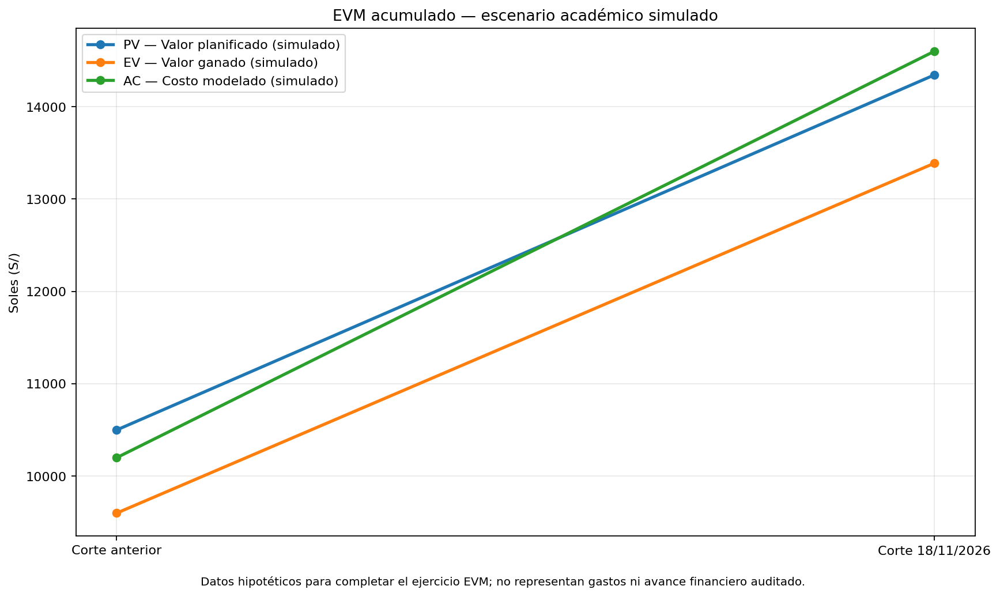
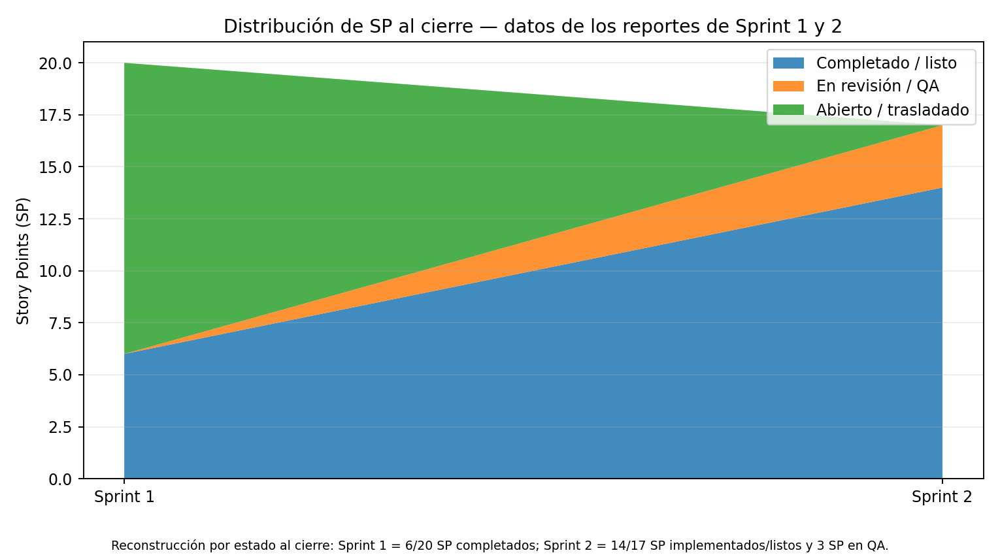
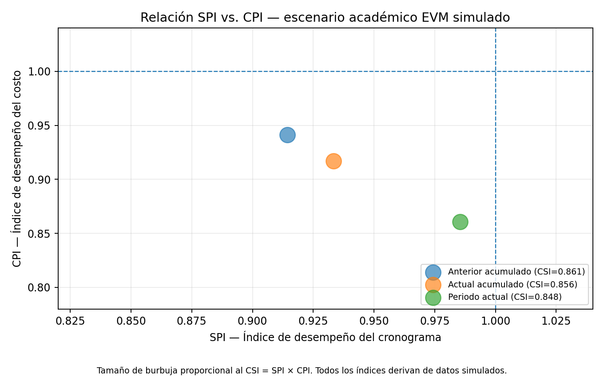
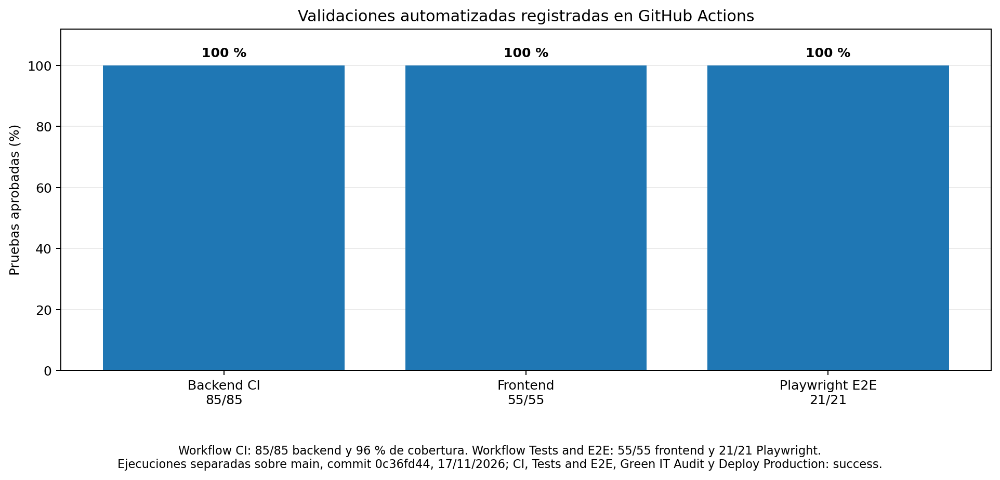

# 04. Tableros de Control Híbridos (Hybrid Dashboards)

[← Volver al README principal](../../README.md)

| Campo | Información |
|---|---|
| Proyecto | EcoLogística Huancayo (EcoLogistics) |
| Frecuencia de actualización | Al cierre de cada sprint y ante merge/release; corte de esta versión: 21/11/2026 |
| Versión | V_1_0_0 |

## 1. Justificación de métricas — principio Less is More

Los interesados académicos necesitan conocer si el MVP se puede demostrar, si la calidad técnica está controlada, qué alcance fue realmente entregado y qué elementos siguen pendientes. Se priorizan cuatro indicadores: estado de módulos y entregables (RAG), salud de CI/E2E, avance/variaciones EVM y trazabilidad de evidencias. La parte EVM es simulada; los estados funcionales se basan en el README y los documentos de sprint.

## 2. Tabla semáforo (RAG) por componente

| Componente / entregable | Enfoque | Estado | Observación / umbral |
|---|---|---|---|
| Backend/API y persistencia | Predictivo + adaptativo | 🟢 Verde | FastAPI, SQLAlchemy y PostgreSQL organizados en carpetas propias; pruebas registradas. |
| Frontend y navegación | Adaptativo | 🟢 Verde | React/Vite, servicios y componentes separados; build aprobado en CI. |
| Gestión de clientes, conductores, vehículos y pedidos | Adaptativo | 🟢 Verde | Módulos funcionales documentados en README. |
| Planificación manual de rutas | Adaptativo | 🟡 Ámbar | Funcionalidad delimitada; no se debe confundir con cálculo geográfico automático. |
| Optimización automática, mapas y reoptimización | Predictivo | 🔴 Rojo | No implementados en la versión documentada; diferidos. |
| Indicadores de combustible/CO₂e por recorrido | Predictivo | 🔴 Rojo | No calculados por ruta; fuera de la capacidad actual declarada en README. |
| CI, pruebas automatizadas y despliegue | Predictivo + adaptativo | 🟢 Verde | CI, Tests and E2E, Green IT Audit y Deploy Production terminaron `success` el 17/11/2026 sobre `0c36fd44`. CI registró backend 85/85 con 96 % de cobertura; Tests and E2E registró frontend 55/55 y Playwright 21/21. |
| Datos demostrativos y acceso | Adaptativo | 🟢 Verde | El responsable reportó carga exitosa en Neon y login válido con cuentas de demostración el 21/11/2026; falta conservar captura de conteos como evidencia del repositorio. |
| Cierre documental y audiovisual | Predictivo | 🟡 Ámbar | Los siete reportes y guiones están preparados en el paquete de entrega; falta integrar a `main`, verificar enlaces en GitHub y grabar el MP4. |

## 3. Gráficos de desempeño predictivo y ágil

### 3.1 Tendencias de variación y valor ganado (líneas)

**Interpretación:** la línea EV queda por debajo de PV y AC por encima de EV en el escenario de ejemplo. Los datos EVM son simulados, no un registro de horas ni gastos.

### 3.2 Flujo acumulado / distribución de SP por sprint

**Interpretación:** Sprint 1 cerró con 6 de 20 SP registrados como completados y 14 trasladados; Sprint 2 implementó 17 SP técnicamente, con 14 listos y 3 en revisión/QA al último corte del informe. No es un CFD diario exportado de Jira; es una reconstrucción de estados de cierre.

### 3.3 Relación costo-cronograma (SPI vs. CPI con tamaño CSI)

**Interpretación:** los tres puntos se ubican por debajo del umbral 1, indicando ineficiencia en el escenario simulado. El tamaño representa CSI = SPI × CPI.

### 3.4 Medidores / barras de calidad

**Interpretación:** se reportan resultados aprobados de backend, frontend y E2E en ejecuciones locales documentadas por separado. Los workflows remotos se verificaron como `success` el 17/11/2026; los conteos y porcentajes no sustituyen una aceptación de usuarios.

## 4. Frecuencia y responsables de actualización

| Indicador | Fuente | Frecuencia | Responsable de actualización |
|---|---|---|---|
| RAG por módulo | README, PR y revisión funcional | Por sprint / release | Dirección del proyecto |
| CI y E2E | GitHub Actions | Por push y PR | Responsable técnico |
| EVM | Línea base de presupuesto y supuestos registrados | Al cierre del periodo | Dirección del proyecto |
| Evidencias ágiles | Jira y retrospectivas versionadas | Al cierre de cada sprint | Responsable de seguimiento |

---

**Nota de uso:** no atribuir los gráficos EVM simulados a resultados reales. El tablero RAG sí describe el alcance funcional registrado al corte; la clasificación roja de optimización, mapas y sostenibilidad evita sobredeclarar capacidades.
