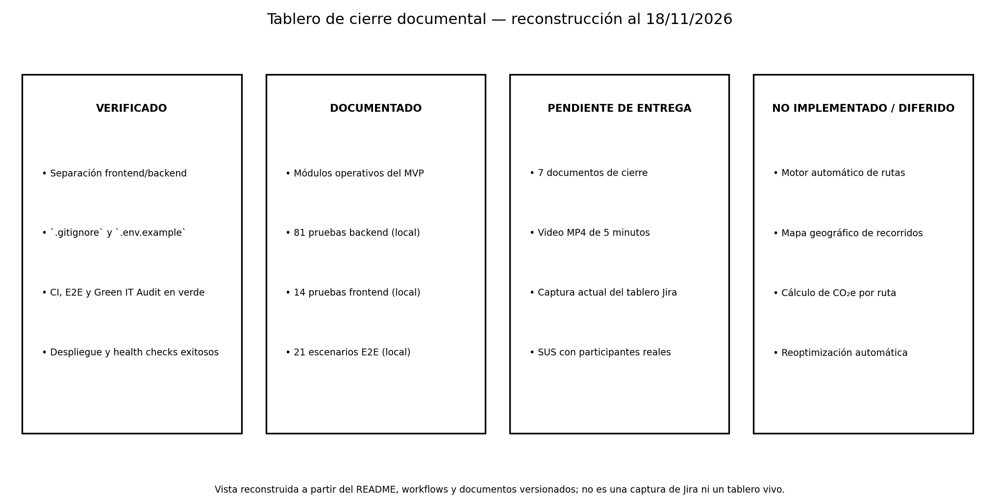
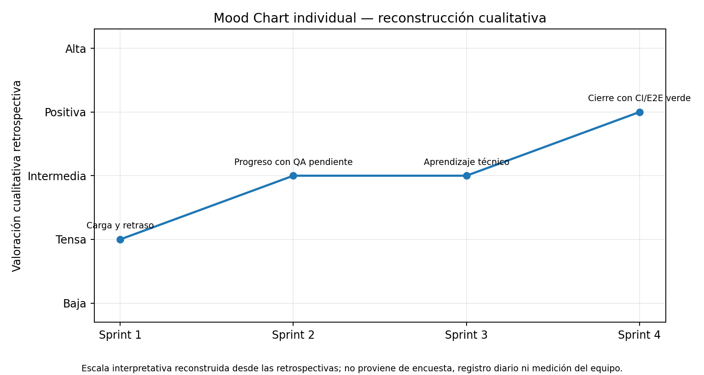
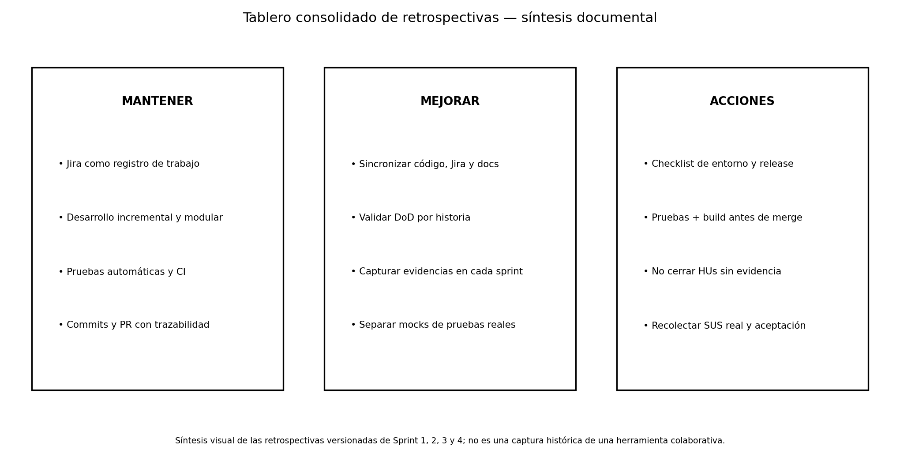

# 05. Radiadores de Información (Information Radiators)

[← Volver al README principal](../../README.md)

| Campo | Información |
|---|---|
| Proyecto | EcoLogística Huancayo (EcoLogistics) |
| Marco ágil documentado | Scrum con seguimiento en Jira y enfoque de gestión híbrido |
| Versión | V_1_0_0 |
| Corte | 21/11/2026 |

## 1. Burndown Chart — trabajo restante

**Análisis:** la evidencia histórica de Sprint 1 muestra 20 SP comprometidos y 14 SP restantes al cierre; Jira registró 6 SP completados (30 %). El reporte indica que las seis HUs se incorporaron al alcance el 11/09 aunque el Sprint inició el 09/09. Es una captura real del Sprint 1, no un burndown actualizado al 18/11.

## 2. Burnup Chart — trabajo completado y cambios de alcance

**Análisis:** el Burnup registra 6 SP de trabajo completado en el historial de Sprint 1. No se extrapola esa velocidad a Sprints posteriores porque no hay una serie homogénea de Story Points para los Sprints 3 y 4.

## 3. Task Board / tablero Kanban

### Evidencia histórica disponible

La captura corresponde al tablero de Sprint 1: 4 por hacer, 1 en curso, 1 en revisión/QA y 0 listos. No debe presentarse como tablero vigente del Sprint final.

### Estado de cierre reconstruido

Esta imagen es una reconstrucción documental basada en los archivos y workflows del repositorio; no es una captura de Jira. Resume los elementos verificados, documentados, pendientes y no implementados al corte.

## 4. Mood Chart — autoevaluación retrospectiva individual (no encuesta de equipo)

| Iteración | Lectura cualitativa | Base documental |
|---|---|---|
| Sprint 1 | Carga y fricción por desviación del compromiso y diferencias de entorno | Reporte de estado y retrospectiva de Sprint 1 |
| Sprint 2 | Progreso con cierre de QA aún pendiente para US-011 | Reporte de estado y retrospectiva de Sprint 2 |
| Sprint 3 | Aprendizaje técnico sobre CI, SonarQube y alcance de métricas | Revisión y retrospectiva de Sprint 3 |
| Sprint 4 | Mayor confianza técnica tras E2E multi navegador y despliegue verificado | Revisión y retrospectiva de Sprint 4 |

**Advertencia:** este gráfico es una autoevaluación cualitativa reconstruida desde las retrospectivas escritas. No procede de una encuesta, diario de ánimo ni medición de todos los integrantes. Se usa para aportar transparencia en un cierre individual, no como dato psicométrico del equipo.

## 5. Tablero de retrospectiva

La síntesis se construyó a partir de las retrospectivas versionadas de Sprint 1, Sprint 2, Sprint 3 y Sprint 4. Los principales acuerdos documentados fueron:

- **Mantener:** Jira como registro, desarrollo incremental y modular, pruebas automatizadas, commits y PR trazables.
- **Mejorar:** sincronización entre código/Jira/documentación, aplicación de DoD, capturas durante cada sprint y separación entre mocks y pruebas reales.
- **Acciones:** checklist de entorno y release, pruebas y build antes de integrar, no cerrar historias sin evidencia y recolectar SUS con participantes reales.

---

**Estado de evidencia:** Burndown, Burnup y Scrum Board son capturas históricas presentes en el repositorio. Mood Chart, Kanban de cierre y tablero de retrospectiva son reconstrucciones explícitamente identificadas; para afirmar que son radiadores capturados durante la ejecución, se requiere una captura original de Jira o de la herramienta utilizada.
